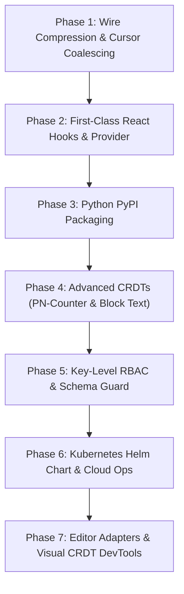

# Syncwell World-Class Improvement Plan

> **Goal:** Transform Syncwell from a rock-solid core CRDT engine (v0.5.0) into a world-class, enterprise-grade, open-source real-time collaboration platform (competing directly with Liveblocks, PartyKit, and Yjs).
>
> **Budget & Cost:** **100% Free and Open Source.** No paid external APIs, no proprietary services, and zero vendor lock-in.

---

## 1. Executive Summary

Syncwell v0.5.0 provides a resilient foundation:
- Correct CRDT mathematics (commutativity, associativity, idempotence)
- Zero-allocation Lamport logical clocks
- Append-only durability, tombstone GC, and crash safety
- Comprehensive test coverage (chaos partitions, WebDriver BiDi E2E, fuzzing)
- Single static binary with zero runtime dependencies

To reach true industry-leading status, we have established a phased improvement roadmap targeting core engine richness, developer experience (DX), protocol efficiency, fine-grained security, and enterprise orchestration.

---

## 2. Phase-by-Phase Roadmap

---

### Phase 1: Wire Protocol Compression & Presence Coalescing
*Focus: Network efficiency, bandwidth reduction, and smooth client cursor movement.*

- **1.1 WebSocket permessage-deflate Compression (RFC 7692):**
  - Enable `upgrader.EnableCompression = true` in `internal/server/server.go`.
  - Enable per-connection write compression (`conn.EnableWriteCompression(true)`).
  - Add compression negotiation verification test (`TestServeWS_CompressionNegotiation`) in `internal/server/transport_test.go`.
  - **Impact:** 60%–80% bandwidth reduction on initial snapshots and large text state transfers.
- **1.2 Client-Side Presence Coalescing:**
  - Add `presenceThrottleMs` option (defaulting to 0/off, configurable up to 50ms) in `clients/javascript/syncwell.js` and `awareness.js`.
  - Buffer and coalesce high-frequency mouse movements (`requestAnimationFrame` / timer) so users never trip server message-rate limits during rapid movements.

---

### Phase 2: First-Class React Integration (`syncwell-client/react`)
*Focus: Seamless developer experience for modern frontend stacks.*

- **2.1 Context & Hooks Package:**
  - Export `./react` subpath in `clients/javascript/package.json`.
  - Provide `<SyncwellProvider room="..." url="..." options="...">`.
  - Core React 18+ hooks:
    - `useSyncwell()`: Access the raw engine instance.
    - `useStorage(key, fallback)`: Reactive subscription to a specific key in the room's CRDT state.
    - `usePresence(initialState)`: Local presence publisher.
    - `useOthers()`: Reactive list of remote peers and their live cursors/states.
    - `useSelf()`: Current user identity and connection status.
    - `useMutation(fn)`: Optimistic, atomic multi-key writes.
    - `useHistory()`: Reactive `undo()`, `redo()`, `canUndo`, `canRedo`.
- **2.2 TypeScript & SSR Safety:**
  - Provide complete TypeScript definitions in `react.d.ts`.
  - Ensure 100% Next.js, Remix, and Vite SSR safety (no `window` crashes during server rendering).

---

### Phase 3: Python Client Packaging for PyPI
*Focus: Making the Python client installable via pip for AI agents, backends, and bots.*

- **3.1 Modern Packaging Configuration:**
  - Create `clients/python/pyproject.toml` with standard build metadata (Hatchling/Flit).
  - Add inline type hints (`py.typed`) to support `mypy` and IDE autocompletion.
  - Package structure: `syncwell` module exporting `SyncwellClient`, `Clock`, and `LWWMap`.
- **3.2 Automated Publishing:**
  - Add PyPI build & publish targets in `Makefile` and `.github/workflows/release-python.yml`.
  - Enable users to run `pip install syncwell-client`.

---

### Phase 4: Advanced CRDT Data Types (PN-Counter & Text Optimization)
*Focus: Expanding the CRDT mathematical capabilities beyond key-value maps.*

- **4.1 PN-Counter (Positive-Negative Counter):**
  - Implement `PNCounter` in `internal/crdt/pncounter.go`.
  - Independent positive ($P$) and negative ($N$) Lamport maps per node.
  - Join-semilattice merge: $P_{merged}[i] = \max(P_A[i], P_B[i])$, $N_{merged}[i] = \max(N_A[i], N_B[i])$.
  - Expose `increment` and `decrement` operations in protocol and client SDKs.
  - Guarantees concurrent likes, votes, and counter updates never lose increments.
- **4.2 Text CRDT Block Optimization:**
  - Optimize `SequenceText` to group continuous typing runs into chunks rather than 1 map register per individual character.
  - Dramatically lowers tombstone GC pressure and JSON serialization overhead for documents exceeding 10,000 words.

---

### Phase 5: Key-Level Access Control (Fine-Grained RBAC)
*Focus: Multi-tenant and enterprise authorization.*

- **5.1 Wildcard Key Authorization:**
  - Extend `TokenClaims` in `internal/server/auth.go` with `AllowedKeys []string` (e.g. `["user:123:*", "chat:*"]`).
  - Add `CanWriteKey(key string) bool` matcher supporting prefix wildcards.
- **5.2 Server Enforcement:**
  - Validate write permissions in `internal/server/hub.go` prior to applying ops or merge payloads.
  - Prevent untrusted clients from modifying administrative, configuration, or other users' private fields.

---

### Phase 6: Cloud Native Deployment & Kubernetes (Helm Chart)
*Focus: Production DevOps and automated scaling.*

- **6.1 Production Helm Chart (`deploy/helm/syncwell/`):**
  - `Chart.yaml`, `values.yaml`, and modular templates (`Deployment`, `Service`, `Ingress`, `HPA`, `PVC`, `ConfigMap`, `Secret`).
  - WebSocket-optimized annotations for NGINX Ingress and Traefik (connection upgrade timeouts).
  - Configurable health and readiness probes (`/healthz`, `/readyz`).
  - Redis clustering mode integration toggles.
- **6.2 Graceful Connection Draining:**
  - Automated pod lifecycle pre-stop hooks to transition `/readyz` to draining state, allowing active WebSocket sessions to migrate without abrupt drops.

---

### Phase 7: Popular Editor Adapters & Visual CRDT DevTools
*Focus: Broad adoption and rapid developer debugging.*

- **7.1 Rich Text & Code Editor Adapters:**
  - `@syncwell/monaco`: Collaborative code editor binding (VS Code editor engine).
  - `@syncwell/tiptap` / `@syncwell/prosemirror`: Rich-text editor binding with shared formatting marks and live presence cursors.
- **7.2 Visual CRDT Inspector (Browser DevTool):**
  - Lightweight debug overlay showing:
    - Current live document state
    - Vector clocks and Lamport counters
    - Active tombstones and GC status
    - Real-time inbound/outbound op stream with causal tie-break explanations

---

## 3. Quality & Verification Gates

For each phase to be considered complete, it must satisfy:
1. **Zero Regression:** All existing suites (`make all`, `make test-python`, `make browser-e2e`, `make chaos`) must remain 100% green.
2. **Dedicated Unit & Integration Tests:** Full test coverage for every newly introduced package or API.
3. **No Added Financial Cost:** All implementations must rely strictly on open-source code and zero external paid infrastructure.
4. **Complete Documentation:** Documentation site (`website/`) and README updated with copy-pasteable usage examples and architectural diagrams.
